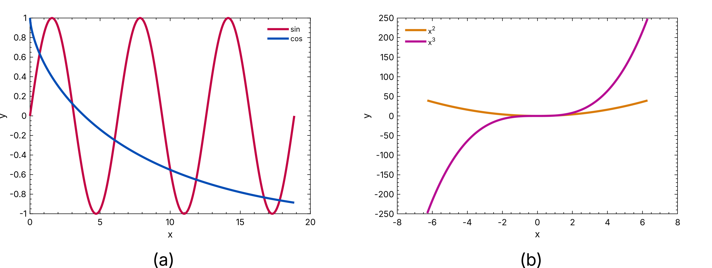

# svgsubfig


A python package for swift arrangement of raster images and vector graphics into a single figure based on SVG.

This package is focussed on the preparation of high quality figures that consist of several subimages, both vector and raster graphics, for publication in scientific journals. A label is inserted below each subimage, e.g. ``(a)``, ``(b)``, ...

Font family, size and gaps can be adjusted based on a JSON configuration. An example figure created with ``svgsubfig`` could look like this:



## Basic usage

### Installation

``svgsubfig`` can be installed using pip:

```console
pip install svgsubfig
```

### Configuration

Create a JSON configuration file with the following structure, use relative filenames for the individual (sub-)images (the directory of the config file acts as base directory).

```json
{
    "gap-between": 5,
    "gap-label": 3,
    "width": 150,
    "font-size": 9,
    "font-family": "Arial, Helvetica, sans-serif",
    "images": [
        "img/dog.jpeg",
        "img/population.svg"
    ],
    "description": [
        "A dog.",
        "The dogs population."
    ]
}
```

Following keys are available for the config file:

- ``description``: Text to be added after each label, either as a flat array in the order of the images, or nested like ``images``.
- ``font-family``: Typeface used in the SVG file for text.
- ``font-size``: Size of the labeling of the images in **pt**.
- ``gap-between``: Spacing between the subimages of a row in **mm**.
- ``gap-label``: Spacing between labels and lower boundary of the images in **mm**.
- ``gap-margin``: Spacing between the subimages and the images in the margins in **mm**, defaults to ``gap-between``.
- ``gap-row``: Spacing between the labels of a row and the images of the next row in **mm**, defaults to ``gap-between``.
- ``images``: Array of file paths of the images to include into the figure, or an array of such arrays to arrange them in rows.
- ``index-offset``: Offset of the first subimage index, e.g. if ``index-offset = 3``, the first label will be ``(d)``
- ``margin``: Images in the margins around the subimages, by side, optionally with their width or height, see below.
- ``width``: Width of the figure in **mm**.

To use automatic conversion of the created SVG figure file into PDF and PNG file formats, [Inkscape](https://inkscape.org/) needs to be installed and accessible on PATH.

#### Rows

To arrange the images in several rows, give ``images`` as an array of arrays, one per row from top to bottom. A single file path in place of an array forms a row of its own. Each row spans the full width of the figure, its images scaled to a common height, and the labels continue row by row:

```json
{
    "images": [
        ["img/dog.jpeg", "img/cat.jpeg"],
        "img/population.svg"
    ],
    "description": [
        ["A dog.", "A cat."],
        ["The pets' population."]
    ]
}
```

#### Margins

To add an image that applies to all subimages, e.g. a common colorbar or legend, put it into one of the margins ``top``, ``bottom``, ``left`` or ``right``, each taking a single image:

```json
{
    "margin": {
        "right": "img/colorbar.svg"
    },
    "gap-margin": 3
}
```

An image in the margin carries no label and is scaled like the subimages based on its physical size, so that e.g. a colorbar of 6 cm x 3 cm next to plots of 9 cm x 6 cm keeps its proportions to them, including the size of its text. If the subimages are scaled differently, e.g. in rows of different numbers of images, their mean scale applies. The physical size of an SVG image is given by its ``width`` and ``height`` in absolute units, and the one of a PNG or JPG image by its resolution, where 96 dpi are assumed if it states none.

To render an image in the margin at a size of its own instead, give it as an object with either its ``width`` or its ``height`` in **mm**, the other one following from its aspect ratio:

```json
{
    "margin": {
        "right": {"image": "img/colorbar.svg", "height": 40},
        "bottom": "img/legend.svg"
    }
}
```

The image is centered along its side: to the left and right on the height from the top of the first row to the bottom of the last row's images, at the top and bottom on the width of the rows, where an image at the bottom follows the labels of the last row. The subimages leave room for images to the left and right, so that the figure keeps its ``width``, and are moved down if these are taller than them.

#### Labels

The labels of a row share a common baseline. The gaps are measured to the ink of the labels, i.e. ``gap-label`` from the images to the tallest glyph and ``gap-row`` from the deepest glyph to the next row, and the figure ends right below the labels of the last row, unless there is an image in the bottom margin. To place the labels exactly, the typeface of ``font-family`` has to be installed, otherwise approximate font metrics are used and a warning is issued.

#### Sub- and superscripts

Descriptions may contain sub- and superscripts in TeX notation, e.g. ``"CO_{2} emission"`` or ``"area in m^{2}"``. Without braces, a script applies to the next character alone, as in ``"x^2"``, and scripts may nest, as in ``"e^{x_{i}}"``. Scripts are set at 70 % of the font size, and the labels are cropped to them as well. For a literal ``_``, ``^``, ``{`` or ``}``, escape it with a backslash, which has to be doubled in JSON, e.g. ``"file\\_name"``.

### Figure composition

To create the final figure using the JSON configuration, a small ``svgsubfig`` command line utility can be used, but also scripting is possible.

#### Command line utility

To use the ``svgsubfig`` module to create the final figure file, use following command in your terminal:

```console
python -m svgsubfig [--noconvert] CONFIG_PATH
```

Replace ``CONFIG_PATH`` with the path of the JSON config file. Option ``--noconvert`` prevents conversion of the created SVG into PDF and PNG with Inkscape, which is useful in case Inkscape is not installed, or manual edits on the created SVG file are necessary.

#### Script

```python
import svgsubfig.utility as util

from svgsubfig import SVGSubFigure
from pathlib import Path

pth_config = Path("figure.json")
pth_svg = pth_config.with_suffix(".svg")

fig = SVGSubFigure.from_json(pth_config)
fig.save(pth_svg)

util.convert_svg(pth_svg)
```
